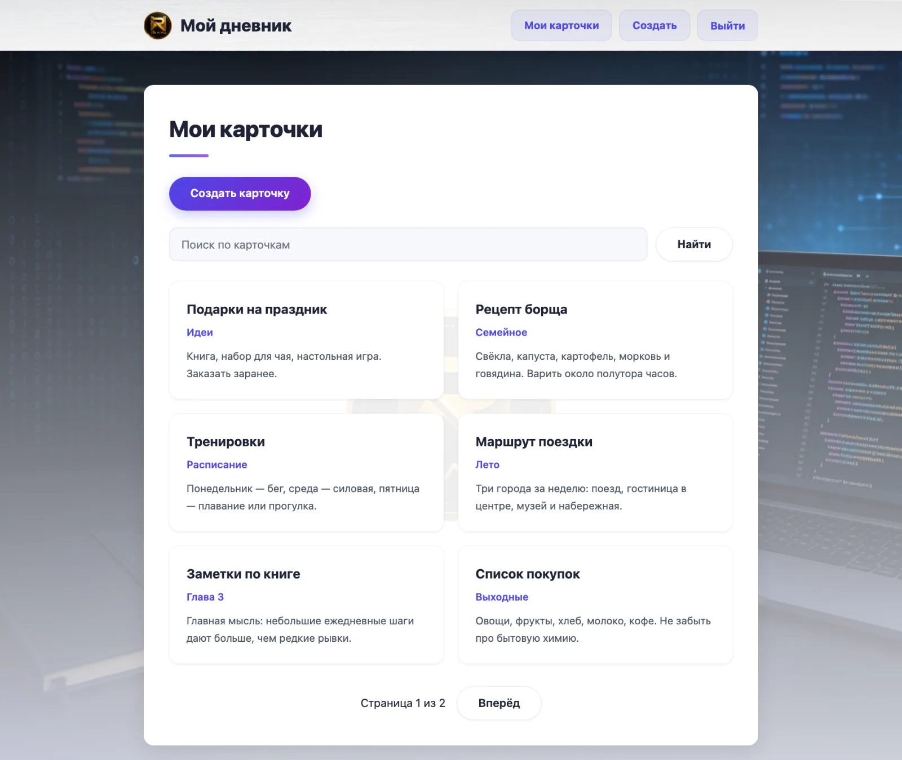
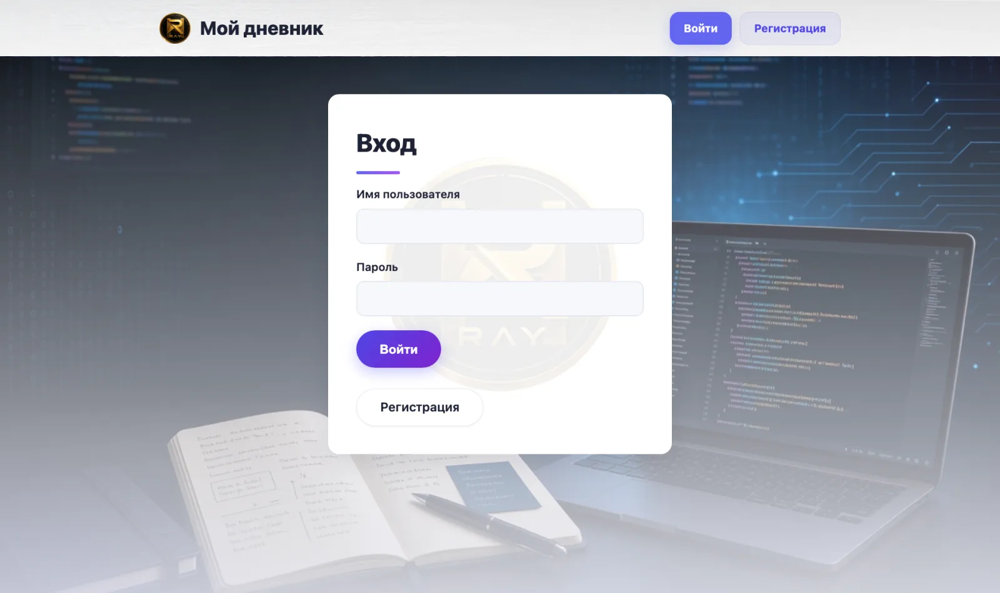
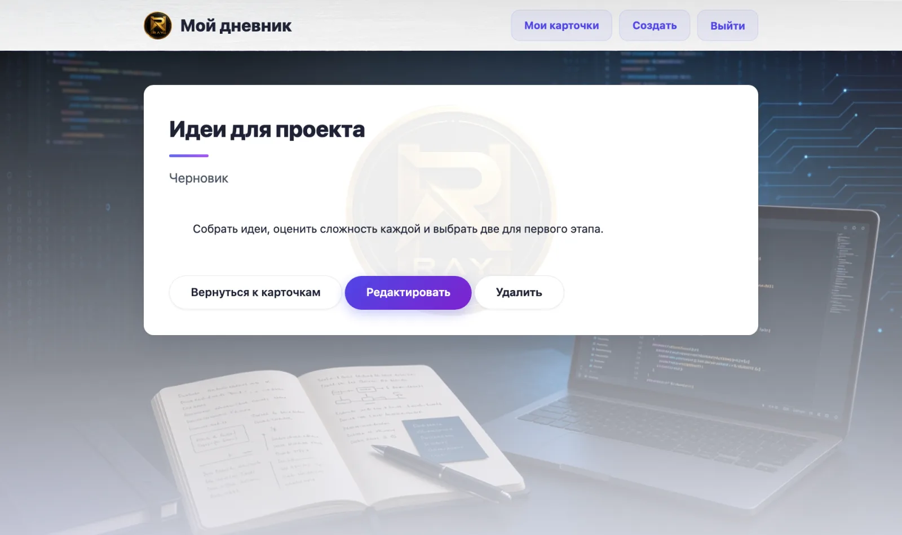
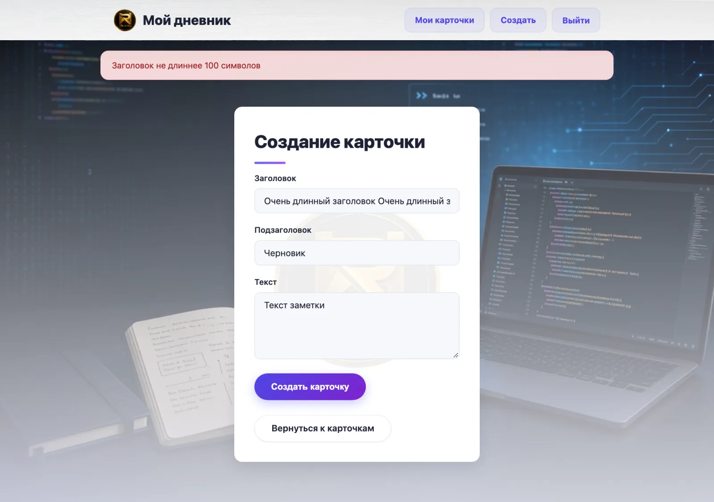
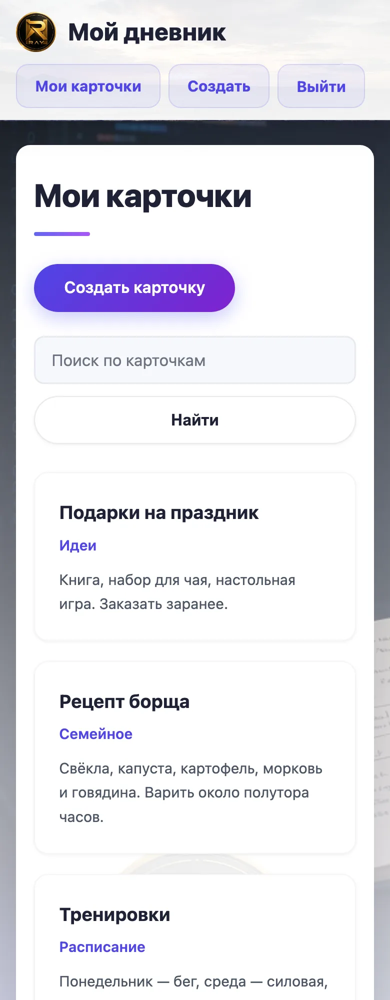

# Flask Diary

Веб-приложение «Дневник» на Flask: регистрация, вход и личные карточки с заметками.

Каждый пользователь работает только со своими карточками: создаёт, редактирует, удаляет, ищет и просматривает их постранично.

## Возможности

- регистрация с проверкой заполнения полей и уникальности имени пользователя;
- вход и выход (Flask-Login), страницы дневника доступны только после входа;
- пароли хранятся в виде хеша;
- карточки принадлежат пользователю: чужие карточки не видны в списке, а прямые ссылки на них возвращают 404;
- полный цикл работы с карточками: создание, просмотр, редактирование, удаление;
- поиск по заголовку, подзаголовку и тексту (без учёта регистра);
- пагинация: 6 карточек на страницу;
- защита всех форм от CSRF (Flask-WTF);
- проверка вводимых данных на сервере и в формах: логин 3–50 символов (буквы, цифры, `.`, `-`, `_`), пароль 8–128 символов, заголовок и подзаголовок до 100, текст до 5000; пробелы по краям обрезаются, при ошибке форма сохраняет введённое;
- ограничение размера запроса (64 КБ);
- ограничение перебора паролей: после 5 неудачных попыток для одного логина с одного адреса (или 20 с одного адреса для любых логинов) вход блокируется на 5 минут, ответ 429 с заголовком `Retry-After`; счётчик хранится в базе, поэтому работает при нескольких процессах сервера;
- страницы ошибок 400, 404, 405, 413 и 500 в стиле сайта: они не зависят от базы данных, не показывают детали ошибки и введённые пользователем данные;
- сообщения об ошибках и успехе через `flash`.

## Скриншоты

Данные на снимках демонстрационные.

**Список карточек** — поиск, карточки пользователя, пагинация по 6 штук:



**Вход** и **просмотр карточки** с действиями «Редактировать» и «Удалить»:

<p>
  
  
</p>

**Проверка данных:** при слишком длинном заголовке показывается понятное сообщение, а введённое сохраняется:



**Мобильная версия** (ширина 390 px):



## Технологии

Python 3, Flask, Flask-Login, Flask-SQLAlchemy, Flask-Migrate, Flask-WTF, SQLite, PostgreSQL, gunicorn, Docker, Jinja2, HTML5, CSS3, pytest, pytest-cov.

## Структура

Приложение собрано по функциям: раздел (страницы, правила, логика) — это отдельный пакет. Подробности и инструкции по расширению — в [руководстве по архитектуре](../docs/architecture.md).

```
flask-diary/
├── main.py                 # точка входа: gunicorn main:app, flask --app main
├── diary/
│   ├── __init__.py         # create_app(): фабрика приложения, список разделов
│   ├── extensions.py       # db, migrate, csrf, login_manager
│   ├── settings.py         # настройки из окружения
│   ├── logging_setup.py    # журнал
│   ├── models/             # модели: user.py, card.py, login_attempt.py
│   ├── core/               # главная, /health, страницы ошибок
│   ├── auth/               # регистрация, вход, выход, ограничение попыток
│   │   ├── views.py        # маршруты (тонкие)
│   │   ├── services.py     # логика
│   │   └── validation.py   # проверка данных
│   ├── cards/              # карточки: views.py, services.py, validation.py
│   ├── templates/          # base.html и папки auth, cards, core, errors
│   └── static/             # css, img
├── migrations/             # миграции базы данных
├── tests/                  # тесты (фикстуры app и client в conftest.py)
├── requirements.txt
├── Dockerfile
├── docker-compose.yml
├── pytest.ini
└── .env.example            # пример переменных окружения
```

## Маршруты

| URL | Метод | Доступ | Описание |
|---|---|---|---|
| `/home` | GET | все | стартовая страница |
| `/health` | GET | все | проверка работоспособности: 200 `{"status": "ok"}` или 503 при недоступной базе |
| `/register` | GET, POST | все | регистрация |
| `/login/` | GET, POST | все | вход |
| `/logout/` | POST | вошедшие | выход (кнопка в шапке, с CSRF-токеном) |
| `/` | GET | вошедшие | свои карточки; параметры `q` (поиск) и `page` |
| `/card/<id>` | GET | владелец | просмотр карточки |
| `/form_create` | GET, POST | вошедшие | создание карточки |
| `/card/<id>/edit` | GET, POST | владелец | редактирование |
| `/card/<id>/delete` | POST | владелец | удаление |

## База данных

SQLite по умолчанию; адрес задаётся переменной `DATABASE_URL`. Поддерживается и PostgreSQL (драйвер psycopg 3). Адреса вида `postgres://…` и `postgresql://…`, которые выдают хостинги, приводятся к нужному виду автоматически, для PostgreSQL включена проверка соединения перед использованием:

```bash
export DATABASE_URL="postgresql://пользователь:пароль@хост:5432/имя_базы"
flask --app main db upgrade
```

Автотесты в CI выполняются и на SQLite, и на PostgreSQL 16. Чтобы запустить их на своём PostgreSQL, задайте `TEST_DATABASE_URL` с адресом **отдельной тестовой** базы: тесты создают и удаляют в ней таблицы. Схема управляется миграциями (Flask-Migrate / Alembic), они лежат в `migrations/`.

```bash
flask --app main db upgrade                      # применить миграции
flask --app main db migrate -m "описание"        # создать миграцию после изменения моделей
flask --app main db downgrade                    # откатить последнюю миграцию
```

Если у вас осталась база, созданная до появления миграций, отметьте её текущей версией: `flask --app main db stamp head`. В Docker миграции применяются автоматически при старте контейнера. Автотест следит, чтобы миграции совпадали с моделями.

- `users` — `id`, `username` (уникальное), `password` (хеш);
- `card` — `id`, `title`, `subtitle`, `text`, `user_id` (владелец).

## Версии Python

Нужна Python 3.12 или новее. В CI тесты выполняются на 3.12 и 3.14, Docker-образ и публикация используют 3.12 (файл `.python-version`).

## Запуск

```bash
python3 -m venv .venv
source .venv/bin/activate
pip install -r requirements.txt
export SECRET_KEY="длинная-случайная-строка"
flask --app main db upgrade      # создать или обновить таблицы
FLASK_DEBUG=1 python main.py
```

Приложение откроется на http://127.0.0.1:5000.

### Переменные окружения

| Переменная | Назначение | По умолчанию |
|---|---|---|
| `APP_ENV` | `development` или `production` | `development` |
| `SECRET_KEY` | ключ подписи сессий и токенов | значение для разработки только в `development` |
| `DATABASE_URL` | адрес базы данных (SQLite или PostgreSQL) | `sqlite:///diary.db` |
| `TEST_DATABASE_URL` | адрес тестовой базы для автотестов | SQLite в памяти |
| `LOG_LEVEL` | уровень журнала: `DEBUG`, `INFO`, `WARNING`, `ERROR` | `INFO` |
| `FLASK_DEBUG` | `1` включает отладку при `python main.py` | выключено |

В режиме `production` приложение не запустится без надёжного `SECRET_KEY` (не короче 16 символов, не значение для разработки). Пример — в `.env.example`. Случайный ключ можно получить так: `python3 -c "import secrets; print(secrets.token_urlsafe(32))"`.

## Запуск в Docker

Нужны Docker и Docker Compose.

```bash
cp .env.example .env        # затем задайте SECRET_KEY в .env
docker compose up --build
```

Приложение откроется на http://localhost:8000. База хранится в томе `diary-data`, поэтому данные сохраняются между перезапусками контейнера. Внутри контейнера приложение запускается через gunicorn от непривилегированного пользователя.

## Публикация в интернете

Подходит любой хостинг для Python или Docker (например, Render или Railway):

- сборка: `pip install -r requirements.txt` (или Dockerfile из репозитория);
- запуск: `gunicorn main:app`;
- переменные окружения: `APP_ENV=production`, `SECRET_KEY` (обязательно), при необходимости `DATABASE_URL`.

Учтите: на бесплатных тарифах файловая система часто временная, поэтому база SQLite может сбрасываться при перезапуске. Для постоянного хранения нужен том или внешняя база данных (`DATABASE_URL`).

## Тесты

```bash
pip install pytest pytest-cov
pytest -q
pytest --cov=diary --cov-report=term-missing
```

Каждый тест получает своё приложение из фабрики `create_app()` и базу в памяти (рабочая база не затрагивается) и проверяют: регистрацию и вход, защиту страниц, изоляцию карточек между пользователями, создание, редактирование и удаление, поиск, пагинацию и отклонение запросов без CSRF-токена. Покрытие пакета `diary` — около 99%.

## Журнал

Журнал пишется в стандартный вывод (его собирают Docker и хостинги). Логируются регистрация, успешные и неудачные входы, выходы, создание, изменение и удаление карточек (только идентификаторы), необработанные ошибки с трассировкой, а также запросы gunicorn (без параметров адреса).

В журнал не попадают пароли, токены, поисковые запросы и содержимое карточек; введённые пользователем значения очищаются от переносов строк, чтобы нельзя было подделать записи.

## Безопасность

- пароли хешируются (`werkzeug.security`);
- секретный ключ берётся из переменной окружения;
- все POST-формы защищены CSRF-токеном;
- ограничение попыток входа не позволяет заблокировать чужой аккаунт (счёт идёт по паре «адрес + логин») и не выдаёт, существует ли пользователь;
- cookie сессии с флагами `HttpOnly` и `SameSite=Lax`, а в режиме `production` ещё и `Secure`;
- за прокси хостинга учитываются заголовки `X-Forwarded-For`, `X-Forwarded-Proto` и `X-Forwarded-Host` (один прокси), чтобы видеть настоящий адрес клиента;
- доступ к карточкам проверяется по владельцу на сервере.

## Планы по развитию

- миграции базы данных (Flask-Migrate);
- серверная валидация длины полей и более подробные сообщения об ошибках;
- публикация приложения по постоянной ссылке.
